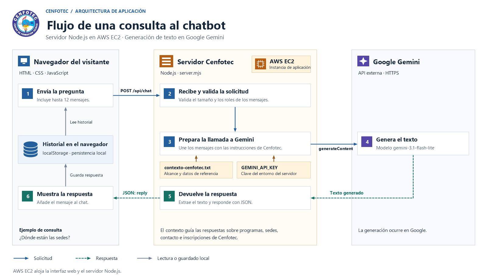

# Arquitectura y funcionamiento

El archivo [Arquitectura.jpeg](documentacion/Arquitectura.jpeg) conserva la imagen incluida en el paquete de documentación académica. Los [informes y certificados](DOCUMENTACION_PRINCIPAL.md) complementan la descripción técnica de esta página.

## Componentes

| Componente | Responsabilidad |
| --- | --- |
| Navegador | Presenta el chat y conserva conversaciones y tema en localStorage |
| Node.js | Sirve HTML, CSS y JavaScript y recibe POST /api/chat |
| contexto-cenfotec.txt | Define alcance, reglas y datos institucionales |
| Gemini API | Genera texto con gemini-3.1-flash-lite |
| Docker en EC2 | Ejecuta Node.js y publica el puerto de la aplicación |

## Recorrido de una consulta

1. El visitante escribe o usa una opción del menú.
2. JavaScript selecciona hasta 12 mensajes, incluida la pregunta actual. Excluye el saludo y las respuestas antiguas del prototipo que carecen de la marca de generación por IA.
3. El navegador envía JSON a `POST /api/chat` en el mismo origen.
4. Node.js valida formato, roles y longitud. Convierte las respuestas del asistente al rol `model` de Gemini y agrupa turnos consecutivos del mismo rol.
5. El servidor envía `contents` y `systemInstruction` a `generateContent` mediante HTTPS. La clave viaja en `x-goog-api-key`.
6. Google devuelve el texto. Node.js extrae las partes de texto y responde con `{"reply":"..."}`.
7. La interfaz muestra el texto y guarda la conversación en el navegador.

## Límites implementados

- Hasta 4.000 caracteres por mensaje y 12 mensajes por consulta.
- Cuerpo de solicitud de hasta 300.000 bytes.
- Hasta 20 consultas por minuto por dirección de conexión y 8 llamadas simultáneas por proceso.
- Tiempo máximo de la llamada a Google de 25 segundos.
- Hasta 1.024 tokens de salida con pensamiento mínimo.
- La respuesta debe finalizar con `STOP` y ocupar como máximo 4.000 caracteres.
- Los mensajes se insertan usando `textContent`.
- El servidor publica únicamente los archivos definidos en su lista de rutas.

La limitación por IP usa la dirección del socket. Si se añade un proxy inverso, se debe revisar ese cálculo porque varios visitantes pueden aparecer con la misma dirección.

## Persistencia

El historial pertenece al navegador y dispositivo del visitante. El backend procesa el historial recibido en cada llamada. La información institucional se incorpora en cada consulta desde el contexto cargado en memoria al inicio.

## Alcance de las instrucciones

Las reglas orientan las respuestas hacia Cenfotec y exigen confirmar información incompleta o contradictoria. La respuesta sigue siendo generada por un modelo y requiere evaluación de calidad. Las pruebas de despliegue comprueban conexión y ejemplos concretos de respuesta.
